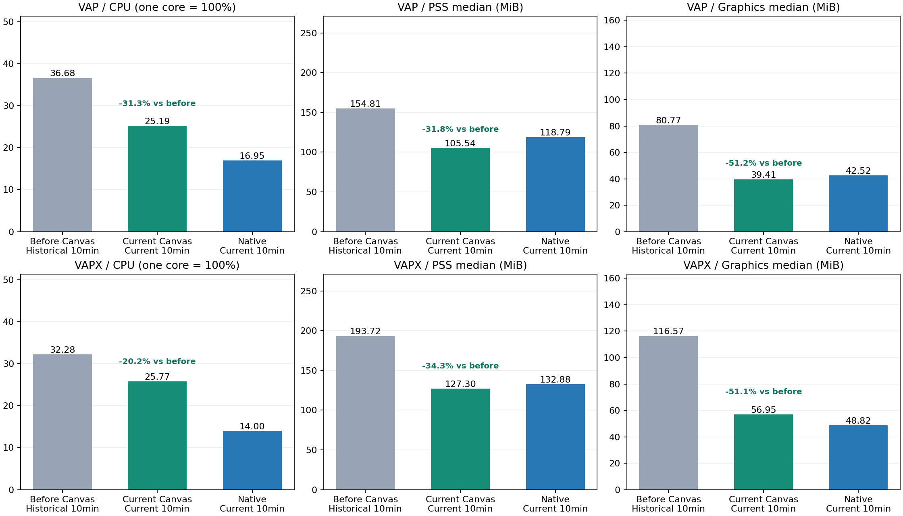
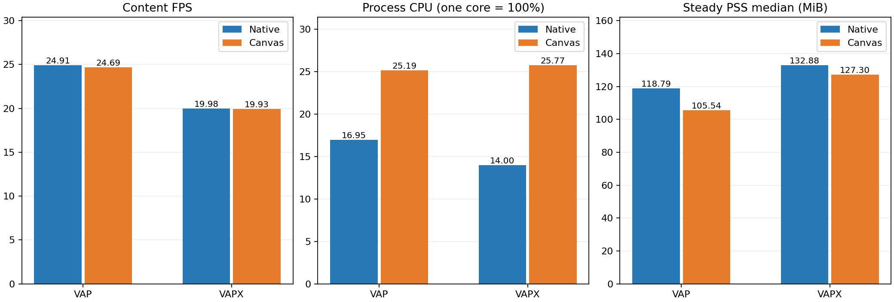
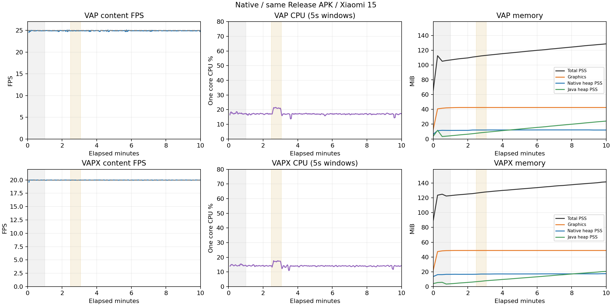
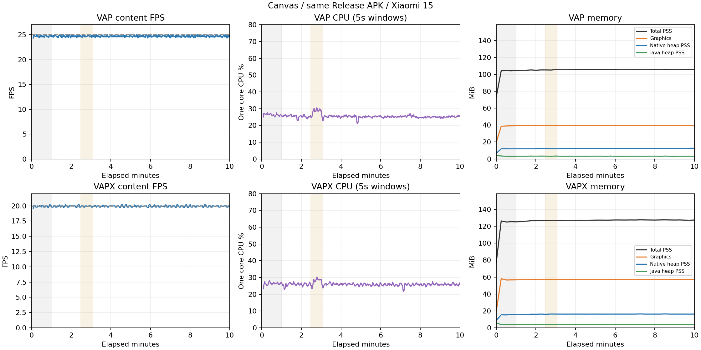
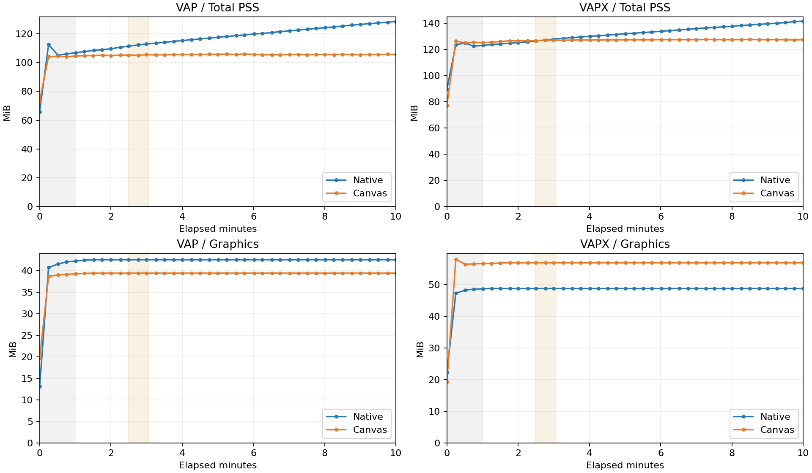
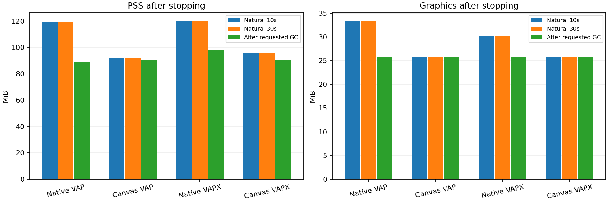
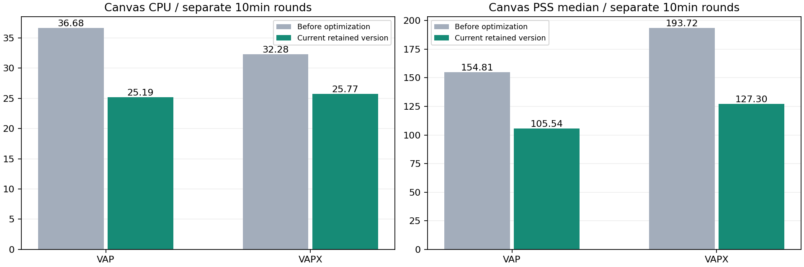

# VAP 三方对比 · 优化前Canvas / 当前Canvas / 原生

2026-11-10 · Xiaomi 15（24129PN74C）· Android API36 · 单路播放基准

[返回库README](../../../README.md) · [在线查看网页版](https://rejigtian.github.io/kmp-vap/performance/2026-11-10/report.html) · [下载HTML离线版](report.html) · [数值、来源与计算公式](metrics.json)

本页可在 GitHub/GitLab 的 Markdown 预览中直接阅读。HTML 下载后用浏览器打开，图表已内嵌，无需启动本地服务。

本目录为可移植报告副本。原始日志、Trace、APK及历史完整网页保留在测试归档，未随库分发。历史优化前Canvas与当前版本属于不同轮次；当前Canvas和原生来自本轮相同APK的四组10分钟测试。所有结论限于这台Android设备，不代表iOS/鸿蒙性能。

较优化前Canvas：VAP / VAPX 的CPU下降31.3% / 20.2%，PSS下降31.8% / 34.3%

优化前Canvas采用历史10分钟数据，当前Canvas和原生采用本轮10分钟数据，三方并排展示。当前Canvas相对原生：CPU仍高48.6% / 84.0%，PSS低11.2% / 4.2%；VAPX Graphics仍高16.6%。播放器和测试原始数据未改动，旧报告及本页更新前快照保留。

## 三方并排：优化前Canvas、当前Canvas、当前原生

每种素材三行。优化前Canvas取历史有效10分钟测试，当前Canvas与原生取本轮同APK四组10分钟；同原机、同素材、相同主要统计口径。历史前后比较属于跨轮参考，运行时间、系统缓存/JIT/温度可能不同；当前Canvas与原生属于本轮同口径对照。内存均为稳态中位数，Graphics是分项，不能与总PSS相加。

| 素材 | 版本 / 数据批次 | 内容FPS | CPU | PSS中位 | Graphics中位 |
| --- | --- | --- | --- | --- | --- |
| VAP | 优化前Canvas · 历史10分钟 | 24.68 | 36.68% | 154.81 MiB | 80.77 MiB |
| VAP | 当前Canvas · 本轮10分钟 | 24.69 | 25.19% | 105.54 MiB | 39.41 MiB |
| VAP | 原生Native · 本轮10分钟 | 24.91 | 16.95% | 118.79 MiB | 42.52 MiB |
| VAPX | 优化前Canvas · 历史10分钟 | 19.93 | 32.28% | 193.72 MiB | 116.57 MiB |
| VAPX | 当前Canvas · 本轮10分钟 | 19.93 | 25.77% | 127.30 MiB | 56.95 MiB |
| VAPX | 原生Native · 本轮10分钟 | 19.98 | 14.00% | 132.88 MiB | 48.82 MiB |

## 当前Canvas相对优化前：CPU与内存下降幅度

以历史优化前Canvas为分母：下降幅度=(优化前−当前)/优化前×100%。CPU绝对差用“个百分点”，内存绝对差用MiB。变化按未舍入的原始值计算。以下是两轮10分钟汇总值的比较，不是同一轮内切换版本的随机化实验。

| 素材 | CPU变化 | PSS变化 | Graphics变化 |
| --- | --- | --- | --- |
| VAP | 下降31.3%（-11.49个百分点） | 下降31.8%（-49.28MiB） | 下降51.2%（-41.36MiB） |
| VAPX | 下降20.2%（-6.52个百分点） | 下降34.3%（-66.42MiB） | 下降51.1%（-59.61MiB） |

## 当前Canvas相对本轮原生：剩余差距与内存优势

以本轮原生为分母。CPU依然升高，不能写成下降；VAPX Graphics也高于原生。总PSS较低与图形分项较高可以同时成立，不能只看一个内存指标。

| 素材 | CPU变化 | PSS变化 | Graphics变化 |
| --- | --- | --- | --- |
| VAP | 升高48.6%（+8.23个百分点） | 下降11.2%（-13.26MiB） | 下降7.3%（-3.11MiB） |
| VAPX | 升高84.0%（+11.77个百分点） | 下降4.2%（-5.58MiB） | 升高16.6%（+8.13MiB） |

## 本次四组10分钟：相同口径结果

全部为本次重新采集，原生和Canvas运行于相同Release APK、相同页面与本地素材；每组新进程、384dp Fit、静音、单路无限循环、60Hz窗口。CPU为App进程累计CPU时间/有效墙钟时间，以单核100%计；不是整机CPU或硬件解码器功耗。

| 素材 / 实现 | 内容帧率 | 进程CPU | 稳态PSS中位 | 稳态PSS观测峰值 | Graphics中位 |
| --- | --- | --- | --- | --- | --- |
| VAP / 原生 | 24.91 fps | 16.95% | 118.79 MiB | 128.63 MiB | 42.52 MiB |
| VAP / Canvas | 24.69 fps | 25.19% | 105.54 MiB | 106.03 MiB | 39.41 MiB |
| VAPX / 原生 | 19.98 fps | 14.00% | 132.88 MiB | 141.60 MiB | 48.82 MiB |
| VAPX / Canvas | 19.93 fps | 25.77% | 127.30 MiB | 127.60 MiB | 56.95 MiB |

## 内存是否增长：看初段、末段和堆分项

PSS初段取60–120秒快照中位数，末段取540–600秒中位数；Java使用量与Native malloc取对应稳态首末各约30秒。PSS是进程共享页分摊后的驻留量，会上下波动；增长数值不单独等于泄漏，也不从10分钟外推小时级稳定。

| 素材 / 实现 | PSS初段→末段 | 初末差 | Java使用量初段→末段 | Native malloc初段→末段 |
| --- | --- | --- | --- | --- |
| VAP / 原生 | 108.49 → 127.57 MiB | +19.08 MiB | 5.17 → 23.91 MiB | 24.00 → 24.03 MiB |
| VAP / Canvas | 104.89 → 105.61 MiB | +0.71 MiB | 3.60 → 3.60 MiB | 24.28 → 24.31 MiB |
| VAPX / 原生 | 124.21 → 140.49 MiB | +16.28 MiB | 4.72 → 20.57 MiB | 28.50 → 28.53 MiB |
| VAPX / Canvas | 126.06 → 127.41 MiB | +1.36 MiB | 4.30 → 4.30 MiB | 27.66 → 27.68 MiB |

## 内存增长如何解读

本轮原生VAP/VAPX的Java使用量分别由5.17→23.91MiB、4.72→20.57MiB，与PSS上升同时发生；Native malloc初末变化很小。停止后请求GC，PSS分别进一步回落至88.91/97.61MiB。Canvas Java/Native malloc初末较平稳，但30秒Trace分别观察到12/25次NativeAlloc自然GC，原生同期未记录GC。因此这些数据描述不同GC节奏下的驻留与使用量，不等于Java存活对象量，也不能单独判定原生发生泄漏；不能把GC切片墙钟时间直接换算成CPU占比。

## 每组30秒呈现交叉检查

每组第150秒附近另采30秒Perfetto。内容帧率来自播放器帧回调，下面的实际呈现数据用于交叉检查；deadline违约只覆盖该30秒，不代表10分钟全程无卡顿。CPU主值排除149–184秒追踪窗口，内存曲线保留该窗口并着色。

| 素材 / 实现 | 实际呈现帧率 | 违约帧 / 可分析帧 | 自然GC次数 | Trace丢失统计 |
| --- | --- | --- | --- | --- |
| VAP / 原生 | 24.88 fps | 0 / 745 | 0 | 0 |
| VAP / Canvas | 24.71 fps | 0 / 739 | 12 | 0 |
| VAPX / 原生 | 19.97 fps | 0 / 597 | 0 | 0 |
| VAPX / Canvas | 19.94 fps | 0 / 596 | 25 | 0 |

## 停止后的回落：自然等待与GC分开

播放满600秒后移除播放器，等待10秒和30秒取自然状态；之后才请求GC，约15秒后观察。播放统计不包含这些阶段。清引用或调用释放不保证系统PSS立即归零。

| 素材 / 实现 | 停止10秒PSS / Graphics | 停止30秒PSS / Graphics | 请求GC后PSS / Graphics |
| --- | --- | --- | --- |
| VAP / 原生 | 118.99 / 33.46 MiB | 119.04 / 33.46 MiB | 88.91 / 25.67 MiB |
| VAP / Canvas | 91.76 / 25.68 MiB | 91.76 / 25.68 MiB | 90.29 / 25.68 MiB |
| VAPX / 原生 | 120.30 / 30.15 MiB | 120.34 / 30.15 MiB | 97.61 / 25.68 MiB |
| VAPX / Canvas | 95.41 / 25.84 MiB | 95.48 / 25.84 MiB | 90.77 / 25.84 MiB |

## 优化前后历史数据：保留且分清测量轮次

下表对比历史优化前10分钟与当前版本10分钟。二者时长、原机、素材和主要采样口径一致，但运行时间、APK版本和系统缓存/温度可能不同，因此属于跨轮参考。同轮Native也一并列出，避免把环境变化全部算成Canvas优化。历史90秒成对测试和撤回试验的网页均保留。

| 素材 / 实现 | 历史优化前CPU | 本轮CPU | 历史PSS中位 | 本轮PSS中位 |
| --- | --- | --- | --- | --- |
| VAP / 原生 | 16.89% | 16.95% | 125.55 MiB | 118.79 MiB |
| VAP / Canvas | 36.68% | 25.19% | 154.81 MiB | 105.54 MiB |
| VAPX / 原生 | 14.05% | 14.00% | 143.09 MiB | 132.88 MiB |
| VAPX / Canvas | 32.28% | 25.77% | 193.72 MiB | 127.30 MiB |

## 历史同口径90秒成对对照

这一轮历史测试专门用优化前归档APK与有效优化版APK做同口径90秒对照，前30秒预热。它不与本次600秒混算降幅；保留原表便于追溯。

| 素材 | 版本 | CPU | PSS中位 | 内容帧率 |
| --- | --- | --- | --- | --- |
| VAP | 优化前 | 37.58% | 161.95 MiB | 24.66 fps |
| VAPX | 优化前 | 33.20% | 196.09 MiB | 19.92 fps |
| VAP | 有效优化后 | 28.05% | 101.23 MiB | 24.71 fps |
| VAPX | 有效优化后 | 24.48% | 129.78 MiB | 19.92 fps |

## 版本与有效性核验

当前版本保留HardwareBuffer显式释放和图片缓存，两个无收益试验均已撤回；本次不修改播放器。四组均满600秒，每15秒一次--local快照，共164份播放快照；前台检查480次，失败0次，生命周期中断0次，进程未重启，无播放错误。当前源码、APK、素材、采集脚本与开始时哈希一致；历史五目录844个文件哈希核验一致。Android结果不代表iOS/鸿蒙设备性能。

## Trace可复核索引

每组对应独立进程和原始Trace，PID/UPID仅用于复核，不代表性能指标。

| 素材 / 实现 | Trace文件 | PID | UPID |
| --- | --- | --- | --- |
| VAP / 原生 | 01_native_vap.pftrace | 9164 | 2 |
| VAP / Canvas | 02_canvas_vap.pftrace | 10811 | 4 |
| VAPX / 原生 | 04_native_vapx.pftrace | 15255 | 1 |
| VAPX / Canvas | 03_canvas_vapx.pftrace | 13270 | 13 |

## 测量限制

- 单台小米15（24129PN74C / API36），固定顺序每组一轮。未随机化多轮，不提供统计显著性或所有设备结论。
- CPU和内容帧率剔除前60秒；CPU另排除149–184秒Perfetto窗口。CPU为App进程单核100%口径。
- PSS中位/观测峰值来自60–600秒每15秒快照，无法捕获每个瞬时峰值。内存曲线没有排除追踪窗口，灰色为预热、金色为追踪。
- App每秒堆计数不等于完整Java/Native分配剖析；本轮没有函数级CPU调用栈或分配调用栈，不据此认定具体函数瓶颈或泄漏根因。
- 只在播放结束后请求GC。自然GC可能由运行时自行触发，不能把它与采集器显式请求混为一谈。
- 历史优化前10分钟和成对90秒数据独立保留，不与本次600秒窗口混算。历史五目录844个原始文件已回读哈希核验，未覆盖。
- 所有网页、图表、原始日志和Trace仅保存在本地，未发布或上传。10分钟不等于小时级无增长证明。
